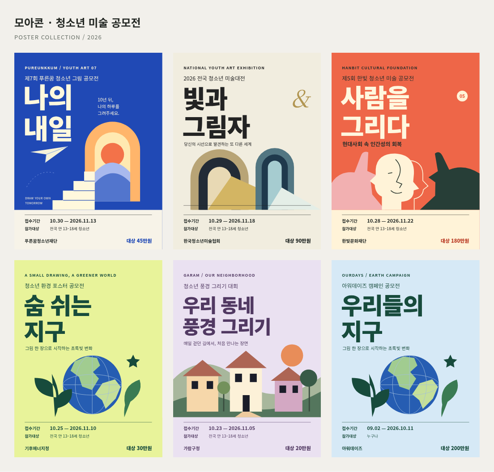

# 공모전 포스터 디자인

## 참고 조사

2026-11-01에 위비티, 콘테스트코리아, 링커리어의 청소년 미술 공모전과 포스터 검색 결과를 살펴봤다.

- [위비티 — 제18회 미래내모습그리기대회](https://www.wevity.com/?c=find&cidx=31&gbn=viewok&gub=2&ix=107201&s=1): 주제를 보여주는 큰 그림과 제목, 하단 접수 안내의 정보 위계 참고.
- [콘테스트코리아 — 2024 국제청소년 디자인·미술 공모전](https://www.contestkorea.com/sub/view.php?Txt_bcode=030610001&Txt_gbn=1&str_no=202404050034): 검색에 노출된 포스터의 큰 타이포그래피와 강한 색 대비 참고. 상세 페이지 직접 열기는 403으로 제한됨.
- [링커리어 — 모란 청소년 입체미술 공모전](https://linkareer.com/activity/197297): 미술기관 공고의 참가대상·일정·주최 정보 구성 참고.

실제 포스터나 기관 로고를 가져오지 않고 가상의 공모전용 벡터 그림을 새로 제작했다.

## 디자인

| 공모전 | 방향 |
| --- | --- |
| 푸른꿈 / 대상 45만원 | 코발트 블루, 큰 ‘나의 내일’ 제목, 종이비행기와 미래로 향하는 계단 |
| 전국 청소년 미술대전 / 대상 90만원 | 미색 종이, 검은 제목, 빛이 드리운 아치와 건축적 그림자 |
| 한빛 / 대상 180만원 | 코럴색, ‘사람을 그리다’ 제목, 서로 마주 보는 얼굴과 겹친 윤곽 |
| 숨 쉬는 지구 | 연두색, 지구와 식물을 결합한 환경 일러스트 |
| 우리 동네 풍경 | 라벤더색, 집·언덕·나무를 배치한 종이 콜라주 스타일 |
| 아워데이즈 / 마감 공고 | 하늘색과 지구 모티프의 캠페인 포스터 |

그 외 공모전은 분야별 그래픽(필름, 책, 음파, 코드, 궤도 등)과 색 조합을 적용했다. 같은 분야는 디자인 체계를 공유한다.

## 유지보수

- `contest/assets/data.js`의 `posterDesign`으로 전용 디자인을 지정한다. 미지정 공모전은 분야별 디자인을 사용한다.
- 렌더링은 `contest/assets/posters.js`, 공통 진입점은 `Moacon.poster()`다.
- 600×800 SVG를 카드·리스트·관련 공모전·상세·확대창에 동일한 비율로 표시한다. 외부 이미지 요청은 없다. 글꼴은 기존 Noto Sans KR 설정을 사용한다.
- 접수기간, 대상 상금, 주최, 참가대상은 기존 공모전 데이터를 사용한다. 전용 포스터의 표제와 그림은 디자인 코드에서 편집한다.
- 공모전 ID, 촬영용 순서(45→90→180), 공모 주제, 즐겨찾기 저장 방식은 유지한다.
- 크게보기는 기본 HTML dialog로 열리며 닫기 버튼, Escape, 배경 클릭으로 닫을 수 있다.

## 확인

Chromium에서 전체 53개 포스터의 텍스트 경계, 320·390·768·1280·1440px 화면의 목록/핵심 상세 5개, 검색·상금 정렬·즐겨찾기 저장·뒤로가기·확대창 닫기 및 키보드 포커스 복귀를 점검했다.
